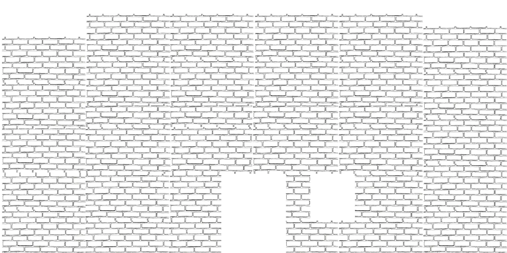

# 🌌 Vishvajeet — 3D Immersive Portfolio & Interactive Experience

<div align="center">



[](https://react.dev/)
[](https://threejs.org/)
[](https://docs.pmnd.rs/react-three-fiber)
[](https://gsap.com/)
[](https://vitejs.dev/)
[](LICENSE)

An award-winning, Awwwards-inspired 3D infinite corridor portfolio and interactive WebGL experience built with **React 19**, **Three.js**, **React Three Fiber (R3F)**, and **GSAP**.

[Explore Live Experience](http://localhost:5173/) • [Key Features](#-key-features) • [3D Rooms](#-interactive-3D-rooms) • [Getting Started](#-getting-started) • [Tech Stack](#-tech-stack)

</div>

---

## 📖 Overview

This portfolio is an interactive virtual space built to merge playful tactile aesthetics (torn paper, pencil sketches, sticker textures) with cutting-edge 3D WebGL graphics and spatial audio. 

Visitors walk down an **infinite 3D corridor**, explore custom-themed rooms, interact with 3D objects, trigger easter eggs, and seamlessly transition into an integrated **Zero WebGL narrative experience**.

---

## ✨ Key Features

- 🚪 **Infinite 3D Corridor**: Dynamic procedural corridor with inertial touch & wheel navigation, door auto-glancing, and smooth teleportation mechanics.
- 🎨 **Torn Paper & Sketch Aesthetic**: Custom hand-drawn textures, SVG clip-paths, and fluid paper transitions powered by GSAP.
- 📱 **Full Cross-Device & Mobile Optimization**:
  - Auto-adapting dynamic camera FOV (`ResponsiveCamera`) for seamless mobile portrait and landscape browsing.
  - Touch-action suppression (`touch-action: none`) eliminating mobile pull-to-refresh jitter.
  - Multi-tier device performance detection (`PerformanceContext`) with automatic texture mipmapping and DPR clamping for a locked 60 FPS.
- 🎧 **Contextual Spatial & Ambient Audio Engine**:
  - Automatically switches ambient audio per section (breeze, sky wind, city hum, ocean waves).
  - Instant mobile audio unlock on first interaction.
- 🏆 **Interactive Gamification & Achievements**: Dynamic achievement unlocks for exploring rooms, discovering hidden bugs, clicking the cat, and traversing the corridor.
- 🔴 **Seamless Zero 3D Narrative Loop**: Integrated high-energy crimson WebGL experience featuring procedural shaders, instant heart-gesture unlock, and seamless loopback to the main entrance doors upon completion.

---

## 🏛️ Interactive 3D Rooms

```
                     ┌───────────────────────┐
                     │   ENTRANCE (Doors)    │
                     └──────────┬────────────┘
                                │
                     ┌──────────▼────────────┐
                     │   INFINITE CORRIDOR   │
                     └─┬──────┬──────┬──────┬┘
                       │      │      │      │
       ┌───────────────┘      │      │      └────────────────┐
       ▼                      ▼      ▼                       ▼
┌──────────────┐   ┌────────────┐  ┌─────────────┐   ┌──────────────┐
│  ABOUT ROOM  │   │  GALLERY   │  │ STUDIO ROOM │   │ CONTACT ROOM │
│ (Sky Flight) │   │ (Projects) │  │  (Monitors) │   │ (Ocean Pier) │
└──────────────┘   └────────────┘  └─────────────┘   └──────────────┘
                                │
                     ┌──────────▼────────────┐
                     │  ZERO 3D EXPERIENCE   │
                     │  (Red Narrative Loop) │
                     └──────────┬────────────┘
                                │
                                └───► (Loop back to Entrance)
```

| Room | Ambient Sound | Description |
| :--- | :--- | :--- |
| **Entrance** | *Acoustic Guitar Breeze* | Double doors with stickers, reactive cat pupils, vintage street lamp, and interactive bug animation. |
| **Corridor** | *Belem Breeze (Main)* | Endless corridor with infinite segment rendering, room doors, and achievements. |
| **About (`/about`)** | *Wind in the Sky* | High-altitude flight with a 3D Paper Airplane navigating floating story clouds and milestones. |
| **Gallery (`/gallery`)**| *City Ambience* | 3D interactive clothesline showcase presenting flagship AI and Full-Stack applications. |
| **Studio (`/studio`)** | *Clean Studio Silence* | Interactive infinite monitor tower and custom workspace showcase. |
| **Contact (`/contact`)**| *Ocean Waves at Pier*| Floating nautical barrel dock with direct social and inquiry portals. |
| **Zero Narrative** | *Zero Cinematic Score* | Intense crimson 3D narrative journey with heart-drawing entry and Tap-Hold corridor return loop. |

---

## 🛠️ Tech Stack

### Core Frameworks & Libraries
- **Frontend Core**: [React 19](https://react.dev/) + [Vite 8](https://vitejs.dev/)
- **3D Graphics & Canvas**: [Three.js (r185)](https://threejs.org/) • [@react-three/fiber](https://docs.pmnd.rs/react-three-fiber) • [@react-three/drei](https://github.com/pmndrs/drei)
- **Animation & Physics**: [GSAP 3](https://gsap.com/) (Observer, ScrollTrigger, Tweens)
- **Styling**: Vanilla CSS / SCSS (SASS 1.102) with custom clip-paths and mixins
- **Performance Profiling**: `r3f-perf` + hardware concurrency auto-tiering
- **Icons & Typography**: [Lucide React](https://lucide.dev/) • `@fontsource-variable/geist` • Google Fonts (Inter, Supply Sans)

---

## 🚀 Getting Started

### Prerequisites
- Node.js (v18.0.0 or higher recommended)
- npm / yarn / pnpm

### Installation

1. **Clone the Repository**
   ```bash
   git clone https://github.com/vishu6213/portfolio.git
   cd portfolio
   ```

2. **Install Dependencies**
   ```bash
   npm install
   ```

3. **Start Development Server**
   ```bash
   npm run dev
   ```

4. **Open in Browser**
   - **Local**: `http://localhost:5173/`
   - **Mobile (Same Wi-Fi)**: `http://<YOUR_LOCAL_IP>:5173/`

### Production Build

```bash
npm run build
npm run preview
```

---

## 📂 Project Structure

```bash
portfolio/
├── public/
│   ├── images/               # Overlay & asset textures
│   ├── sounds/               # Section ambient audios & SFX
│   ├── textures/             # 3D room, door & sketch textures
│   └── zero/                 # Integrated Zero WebGL experience
├── src/
│   ├── components/
│   │   ├── canvas/           # Three.js / R3F Canvas components
│   │   │   ├── corridor/     # Infinite corridor, doors, decorations
│   │   │   ├── entrance/     # Entrance doors, sign system, cat
│   │   │   └── rooms/        # About, Gallery, Studio, Contact rooms
│   │   ├── dom/              # Preloader, paper transitions
│   │   └── ui/               # NavigationUI, audio controls, maps, modals
│   ├── context/              # Audio, Achievements, Performance & Scene providers
│   ├── hooks/                # Camera hooks, document meta, Sanity data
│   ├── styles/               # SCSS design system, mixins, responsive sheets
│   ├── utils/                # Audio manager, device detection, texture preload
│   └── App.jsx               # Application root & 3D canvas mount
├── index.html
├── vite.config.js
└── package.json
```

---

## 📱 Mobile & Responsive Support

- **Portrait & Landscape Mode**: Smart orientation management with non-blocking portrait mode and optional landscape prompt.
- **Unified Touch System**: Smooth single-finger swipe navigation with inertial deceleration.
- **Safe-Area Insets**: Notch and home-indicator protection for modern iOS and Android displays (`viewport-fit=cover`).
- **Resource Clamping**: Dynamic DPR scaling (`Math.min(devicePixelRatio, 1.5)`) prevents mobile GPU thermal throttling.

---

## 👤 Author

**Vishvajeet (VISHU)**
- **Portfolio**: [Live Website](http://localhost:5173/)
- **GitHub**: [@vishu6213](https://github.com/vishu6213)
- **Role**: Developer • Creator • Video Editor • Social Media Expert

---

## 📄 License

This project is licensed under the [MIT License](LICENSE).
